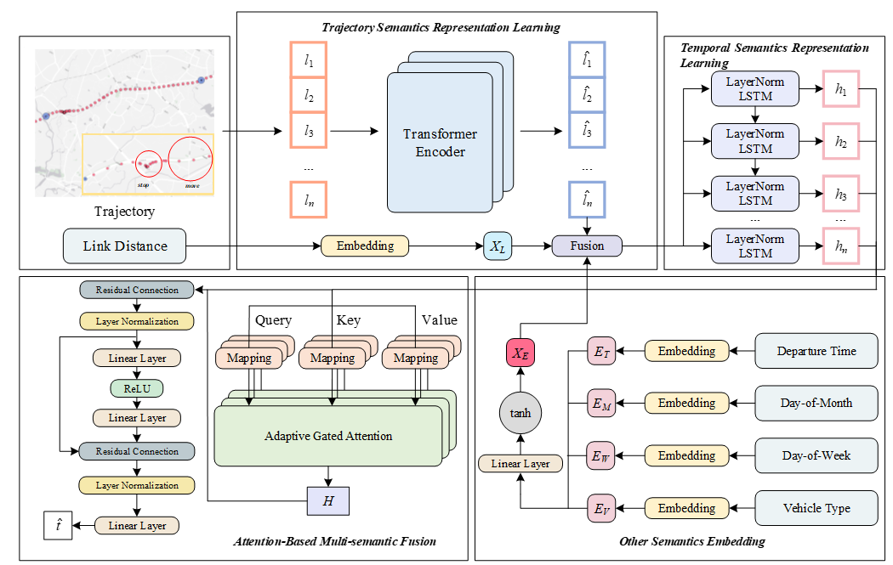

# STR-TTE: Semantic-Enhanced Ultra-sparse Trajectory Representation Learning for Travel Time Estimation

This is a PyTorch implementation of STR-TTE: Semantic-Enhanced Ultra-sparse Trajectory Representation Learning for Travel Time Estimation . 



## Requirements

```
pip install -r requirements.txt
```

## Run
The command of processing is listed bellow: 
```
(base) root@gpu:~/STR-TTE#  python ./main.py --help
usage: main.py [-h] [-m {STR_TTE}] [-M {train,resume,test}]
               [-d {fujian_STR_TTE}] [-i IDENTIFY]
               [-D DEVICE] [-o {Adam}] [-c {rmse,mse,mape,mae,smoothL1}]
               [-cl LOSS_VAL] [-e EPOCHS] [-b BETA] [-l LR] [-w WEIGHT_DECAY]
               [-p PATIENCE] [-r MASK_RATE]

optional arguments:
  -h, --help            show this help message and exit
  -m {STR_TTE}, --model {STR_TTE}
                        input the model name
  -M {train,resume,test}, --mode {train,resume,test}
                        input the process mode
  -d {fujian_STR_TTE}, --dataset {fujian_STR_TTE}
                        input the dataset name
  -i IDENTIFY, --identify IDENTIFY
                        input the specific identification information
  -D DEVICE, --device DEVICE
                        input the chosen device
  -o {Adam}, --optim {Adam}
                        input the chosen optimization function
  -c {rmse,mse,mape,mae,smoothL1}, --loss {rmse,mse,mape,mae,smoothL1}
                        input the chosen loss function
  -cl LOSS_VAL, --loss_val LOSS_VAL
                        intput the specific parameter for loss
  -e EPOCHS, --epochs EPOCHS
                        input the max epochs
  -b BETA, --beta BETA  intput the learning preference between Mask and TTE
                        (the bigger the value, the more preference for TTE.)
  -l LR, --lr LR        intput the initial learning rate
  -w WEIGHT_DECAY, --weight_decay WEIGHT_DECAY
                        intput the weight decay of optimization
  -p PATIENCE, --patience PATIENCE
                        intput the max iteration times of early stop
  -r MASK_RATE, --mask_rate MASK_RATE
                        intput the mask rate of segments in a trajectory

```
For example, you can train the model through the following commands: 
```
python .\main.py --model STR_TTE --dataset fujian_STR_TTE --identify example_0 --device cuda:0    
```
